<div align="center">

# 📦 Traqify

### AI-powered supply chain intelligence

**Turn raw operational data — uploads, shipments, sales — into forecasts, anomaly alerts and reorder decisions in one dark, dashboard-grade Streamlit app.**

[](https://traqify.streamlit.app)
[](#-screenshots)
[](LICENSE)

[](https://www.python.org/)
[](https://streamlit.io)
[](https://www.mysql.com/)
[](https://scikit-learn.org/)
[](https://plotly.com/python/)
[](CONTRIBUTING.md)

[](https://github.com/sus6756/AI-supplychain/stargazers)
[](https://github.com/sus6756/AI-supplychain/commits/main)
[](https://github.com/sus6756/AI-supplychain/issues)
[](https://github.com/sus6756/AI-supplychain)

<sub>If the live demo is asleep, click **“Yes, get this app back up!”** to wake it. First load can take ~30 seconds.</sub>

</div>

---

<div align="center">

### 📸 A look inside

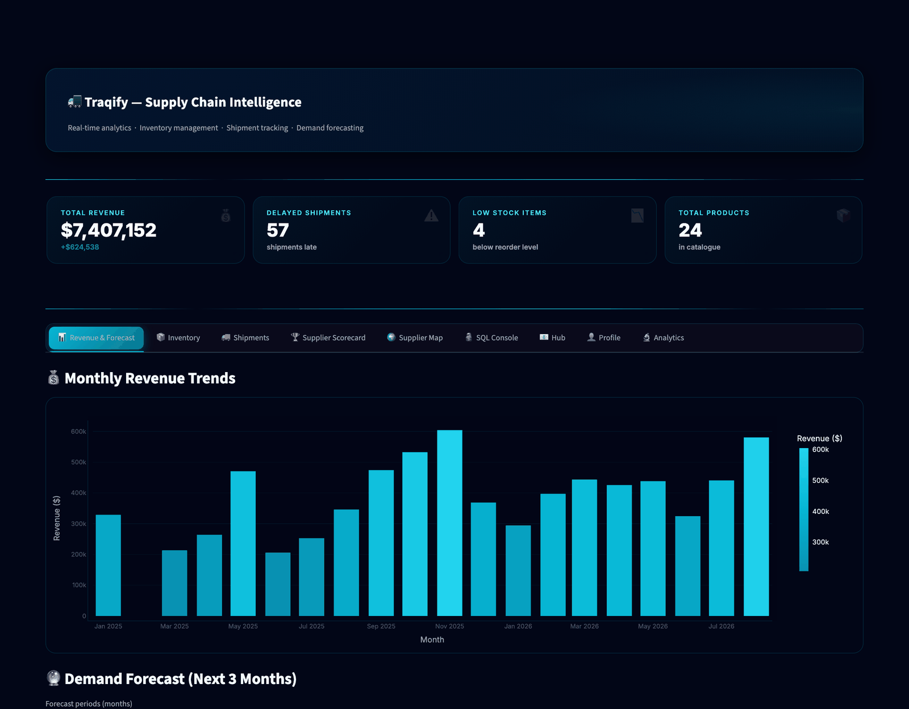

<sub>Revenue & Forecast — animated KPI cards, monthly revenue trends and linear-regression demand forecasting.</sub>

</div>

---

## 📖 Table of contents

- [Overview](#-overview)
- [Screenshots](#-screenshots)
- [Feature tour](#-feature-tour)
- [Architecture](#-architecture)
- [Tech stack](#-tech-stack)
- [Data contract](#-data-contract)
- [Quick start](#-quick-start)
- [Configuration](#-configuration)
- [Project structure](#-project-structure)
- [Under the hood](#-under-the-hood)
- [Admin & security](#-admin--security)
- [Roadmap](#-roadmap)
- [Contributing](#-contributing)
- [Author](#-author)
- [License](#-license)

---

## ✨ Overview

**Traqify** is a full-stack supply chain analytics platform. Point it at a spreadsheet or a
MySQL warehouse and it turns operational records into the things a supply chain team
actually argues about: *what will we sell next quarter, which supplier keeps slipping, what
is about to stock out, and what capital is rotting on the shelf.*

It was built as an **Informatics Practices** capstone and deliberately spans the whole
stack — a custom-themed Streamlit frontend, a MySQL relational backend, scikit-learn
assisted analytics, and automated email + PDF reporting — rather than a single-script
notebook.

<div align="center">

| 🎯 What it answers | How |
| :--- | :--- |
| **How much will we sell?** | Linear-regression demand forecast, next *N* months |
| **Is this month abnormal?** | Z-score revenue anomaly detection |
| **Which supplier is failing?** | Delay anomaly detection + on-time scorecards |
| **What do we reorder, and when?** | Sales-velocity model against stock & reorder level |
| **Where is money trapped?** | Dead-stock identification with tied-up capital |
| **Who is doing what?** | Full activity-log audit trail + admin console |

</div>

---

## 📸 Screenshots

> All screenshots are captured from the real application with
> [`sample/supply_chain_demo.xlsx`](sample/supply_chain_demo.xlsx) loaded —
> 24 products · 10 suppliers · 147 shipments · 18 months of sales.

### 🔐 Authentication

<table>
<tr>
<td width="50%">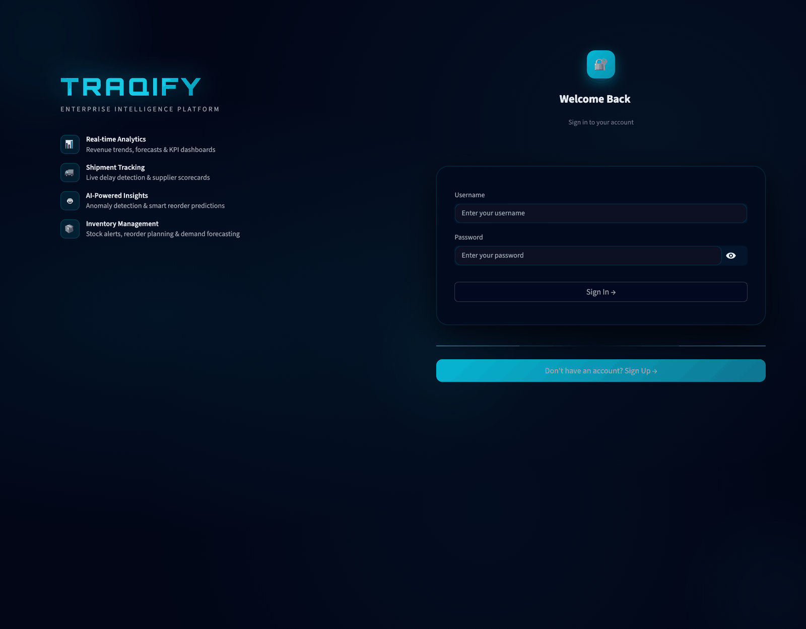<br><sub><b>Split-screen auth</b> — branding panel, glassmorphic card, OTP-verified signup.</sub></td>
<td width="50%">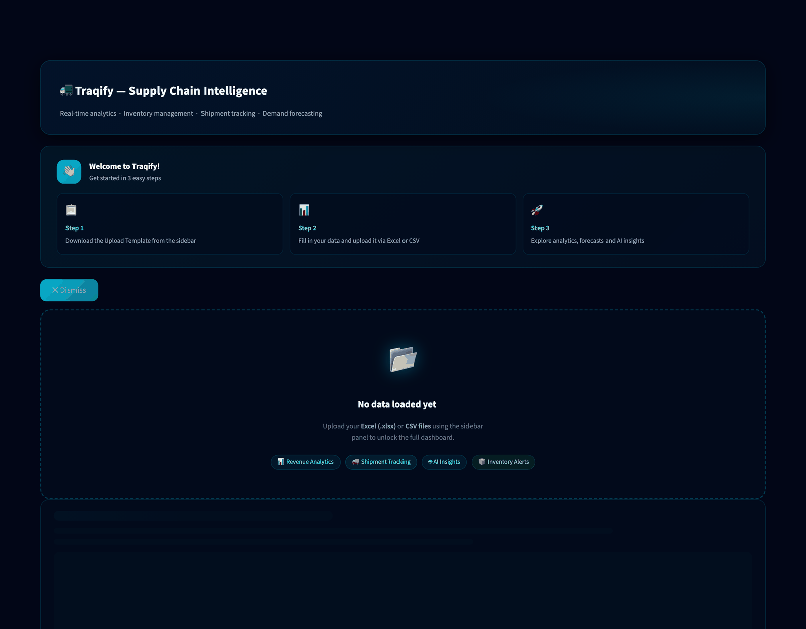<br><sub><b>Guided empty state</b> — the app never shows a blank canvas.</sub></td>
</tr>
</table>

### 📊 Revenue & Forecasting


### 📦 Inventory & Reorder Alerts

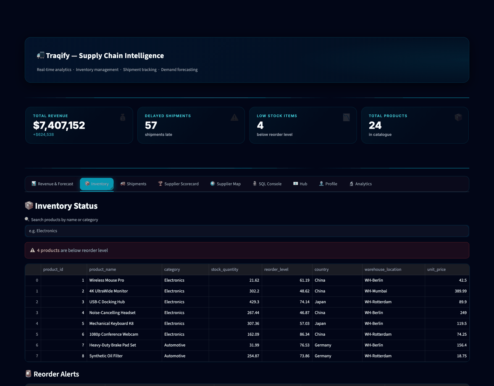

### 🚚 Shipment Tracking

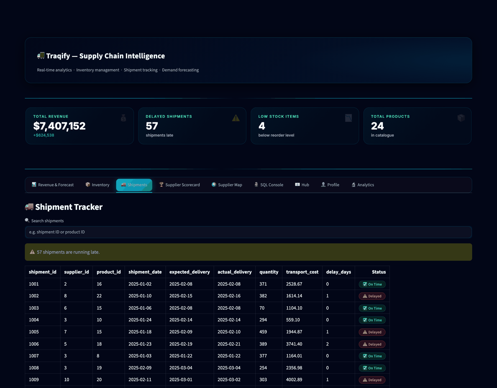

### 🏆 &nbsp;Supplier Scorecard &nbsp;·&nbsp; 🌍 Supplier Map

<table>
<tr>
<td width="50%">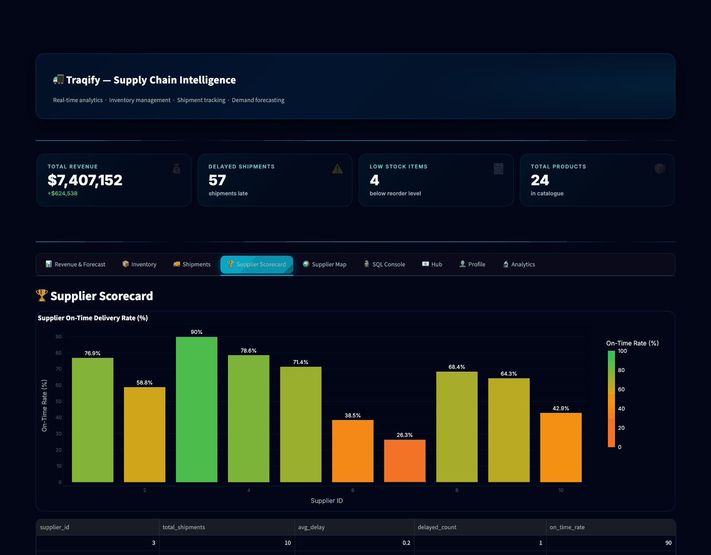<br><sub><b>Scorecards</b> — on-time delivery rate per supplier.</sub></td>
<td width="50%">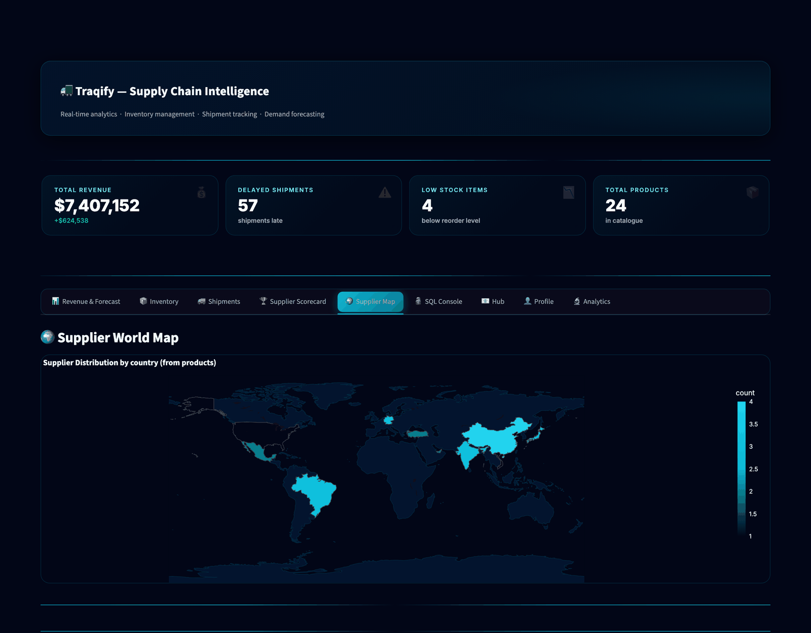<br><sub><b>World map</b> — choropleth of supplier spread by country.</sub></td>
</tr>
</table>

### 🔬 Analytics Suite

<table>
<tr>
<td width="50%">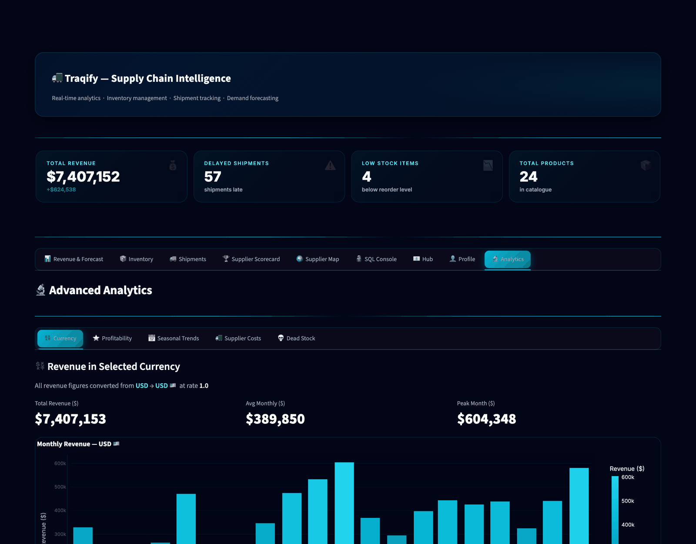<br><sub><b>💱 Multi-currency</b> — 10 currencies, live converted totals.</sub></td>
<td width="50%">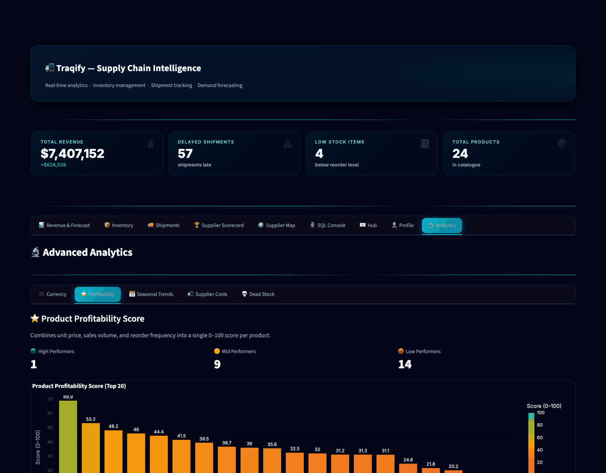<br><sub><b>⭐ Profitability score</b> — price, margin and volume blended.</sub></td>
</tr>
<tr>
<td width="50%">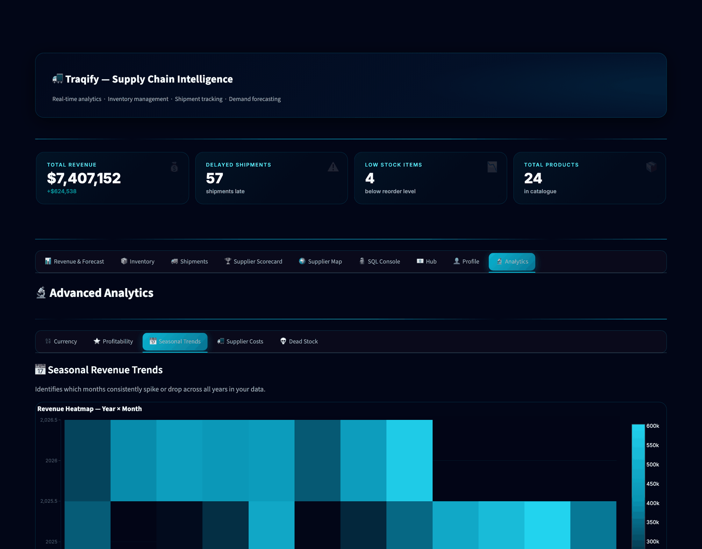<br><sub><b>📅 Seasonal trends</b> — month-over-month seasonality.</sub></td>
<td width="50%">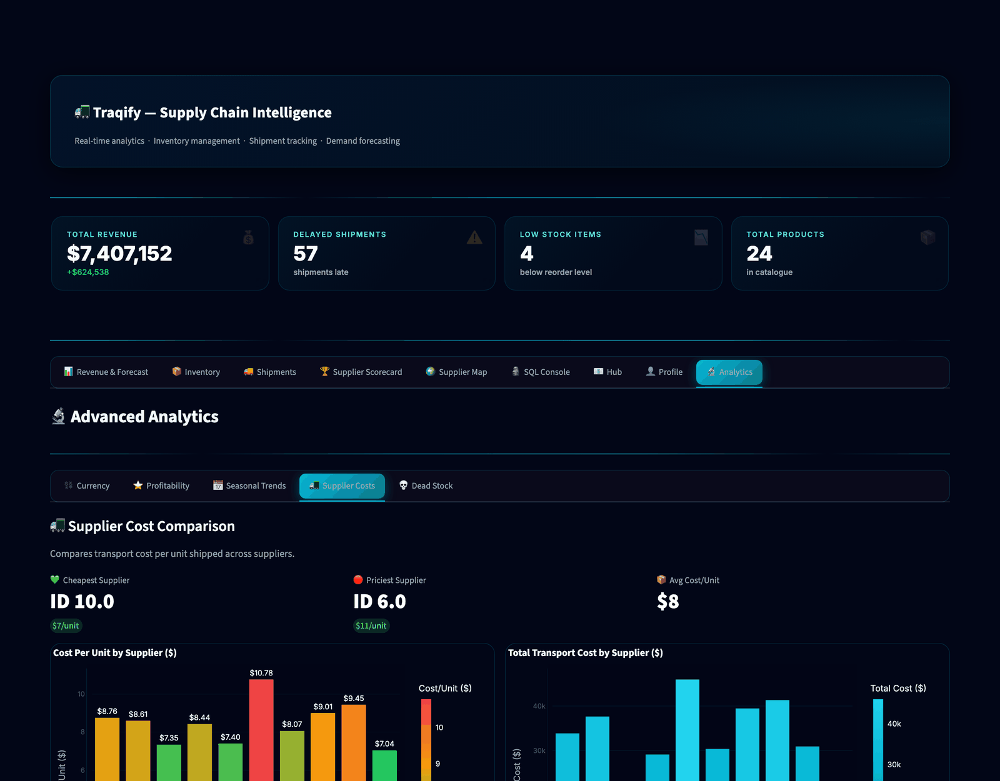<br><sub><b>🚛 Supplier costs</b> — landed transport cost per supplier.</sub></td>
</tr>
<tr>
<td width="50%">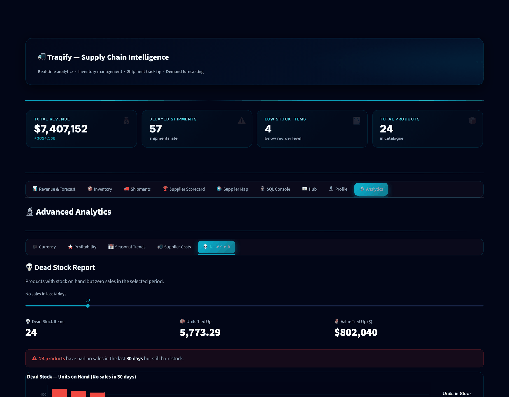<br><sub><b>💀 Dead stock</b> — idle SKUs and the capital tied up in them.</sub></td>
<td width="50%"></td>
</tr>
</table>

---

## 🧩 Feature tour

<details open>
<summary><b>📊 Analytics &amp; reporting</b></summary>

- Real-time KPI header — total revenue, delayed shipments, low-stock items, product count
  (each animated on load, with an automatic currency-aware delta)
- Monthly revenue trends as interactive Plotly bars with hover templates
- **Demand forecasting** for the next *N* months using `scikit-learn` `LinearRegression`
- Multi-currency conversion across **10 currencies** (USD, EUR, GBP, INR, JPY, AUD, CAD, SGD, AED, CNY)
- Product **profitability scoring** — normalised price, stock and volume blended into tiers
- **Seasonal** revenue trend analysis
- **Supplier cost** comparison
- **Dead-stock** identification with tied-up capital valuation
- One-click **Excel export** of the whole dashboard, plus **PDF reports** via `fpdf2`

</details>

<details>
<summary><b>🤖 AI-powered insights</b></summary>

- **Revenue anomaly detection** — z-score over the monthly series, flags outlier months
- **Supplier delay anomaly detection** — flags suppliers whose mean delay breaks from the pack
- **Smart reorder recommendations** — derives daily sales velocity per SKU, projects demand
  over the next *N* days and compares it against stock on hand and reorder level

</details>

<details>
<summary><b>📦 Inventory &amp; shipments</b></summary>

- Inventory table with search, low-stock warning banner and per-row reorder alerts
- Shipment tracker with **On Time / Delayed** badges, delay-day counts and manual status overrides
- Supplier scorecards with on-time delivery rate
- Supplier choropleth world map (auto-detects `country` / `location` / `region` columns)

</details>

<details>
<summary><b>🔐 Accounts, roles &amp; admin</b></summary>

- Signup with **one-time-password email verification** (10-minute expiry, resend support)
- Distinct **user** and **admin** dashboards
- Admin console: user management, password resets, account removal, broadcast announcements
- Conversations inbox — users message the admin, admin replies, thread can be closed
- Full **activity timeline** audit log of every significant action

</details>

<details>
<summary><b>📧 Communications</b></summary>

- Automated **low-stock alert** emails triggered right after a data upload
- **Shipment-delay** alerts
- On-demand **dashboard summary** reports emailed to the signed-in user
- Branded HTML email templates with the Traqify gradient header
- Downloadable **PDF** summaries

</details>

<details>
<summary><b>🗄️ Data sources</b></summary>

- **Excel** (`.xlsx`) workbook upload — `products`, `shipments`, `sales` sheets
- **CSV** upload — three files
- **MySQL** connection with an in-app SQL console (admin-only)
- **Google Sheets** — paste a public sheet URL and load it as sales, products or shipments
- Built-in downloadable **upload template** so new users can't get the columns wrong

</details>

---

## 🏗️ Architecture

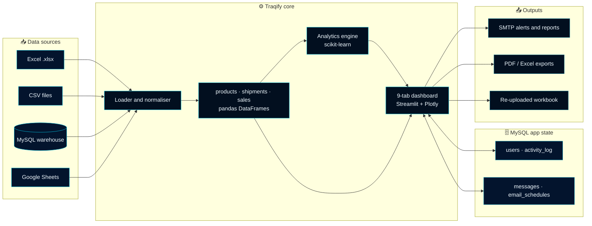

**In one breath:** data enters as a workbook, CSVs, a MySQL result set or a Google Sheet;
a normaliser coerces types and derives `delay_days` and a `status` badge; every tab then
reads from those three frames, while MySQL separately holds authentication and app state.

---

## 🛠️ Tech stack

| Layer | Technology | Why |
| :--- | :--- | :--- |
| **Frontend** | Streamlit · Plotly · custom CSS/JS | Python-only UI with a bespoke design system |
| **Design system** | Deep-navy `#020617` + cyan `#06b6d4` tokens | One palette across charts, cards and native widgets |
| **Backend** | Python 3.11+ · `mysql-connector-python` | Relational state: users, roles, logs, messages |
| **Analytics / ML** | `scikit-learn` · `pandas` · `numpy` | Regression forecasting, z-score anomalies, velocity models |
| **Reporting** | `fpdf2` · `openpyxl` · SMTP | PDF summaries, Excel exports and HTML emails |
| **Config** | `.streamlit/config.toml` · Streamlit secrets | Declarative dark theme, credentials out of source |

---

## 🗃️ Data contract

Traqify expects an `.xlsx` workbook with three sheets. Column names matter — grab the
built-in template from the app sidebar to start from a known-good file.

<table>
<tr><th align="left">Sheet</th><th align="left">Required columns</th></tr>
<tr>
<td><code>products</code></td>
<td><code>product_id</code>, <code>product_name</code>, <code>category</code>, <code>stock_quantity</code>, <code>reorder_level</code>, <code>warehouse_location</code>, <code>unit_price</code></td>
</tr>
<tr>
<td><code>shipments</code></td>
<td><code>shipment_id</code>, <code>supplier_id</code>, <code>product_id</code>, <code>shipment_date</code>, <code>expected_delivery</code>, <code>actual_delivery</code>, <code>quantity</code>, <code>transport_cost</code></td>
</tr>
<tr>
<td><code>sales</code></td>
<td><code>sale_id</code>, <code>product_id</code>, <code>sale_date</code>, <code>quantity_sold</code>, <code>revenue</code></td>
</tr>
</table>

**Derived automatically:** `delay_days = actual_delivery − expected_delivery`, and a
human-readable `status` badge for every shipment. Optional `country` / `location` /
`region` columns light up the supplier world map and RFM-style grouping.

> `sample/supply_chain_demo.xlsx` is a ready-to-upload dataset that satisfies every tab.
> [`sample/generate_demo_dataset.py`](sample/generate_demo_dataset.py) regenerates it.

---

## 🚀 Quick start

### Prerequisites

- Python **3.11+**
- MySQL **8+** (local or remote)
- *Optional:* a Google Cloud service account for Google Sheets loading
- *Optional:* an SMTP account for email alerts

### 1 · Clone &amp; install

```bash
git clone https://github.com/sus6756/AI-supplychain.git
cd AI-supplychain

python -m venv venv
source venv/bin/activate        # Windows: venv\Scripts\activate

pip install -r requirements.txt
```

### 2 · Create the database

```bash
mysql -u root -p -e "CREATE DATABASE supply_chain;"
```

The app creates its own tables on first boot. To seed the schema and sample queries by
hand, run the statements in [`project(mysql part)`](<project(mysql part)>).

### 3 · Configure secrets

`.streamlit/secrets.toml` is **git-ignored** — create it yourself:

```toml
DB_HOST     = "127.0.0.1"
DB_USER     = "your_user"
DB_PASSWORD = "your_password"
DB_NAME     = "supply_chain"
DB_PORT     = "3306"
```

<details>
<summary><b>Optional — SMTP email alerts</b></summary>

```toml
SMTP_HOST     = "smtp.gmail.com"
SMTP_PORT     = "587"
SMTP_USER     = "you@gmail.com"
SMTP_PASSWORD = "your-app-password"
```
</details>

### 4 · Run

```bash
streamlit run project.py
```

Open **http://localhost:8501**, create an account (verify the emailed OTP), then upload
[`sample/supply_chain_demo.xlsx`](sample/supply_chain_demo.xlsx) from the sidebar.

> 💡 **Running on macOS with a local MySQL?** `project.py` pins `ssl_ca` to the Linux CA
> bundle Streamlit Community Cloud provides. Comment that line out for a local server
> without TLS.

<details>
<summary><b>Using a Dev Container / GitHub Codespace</b></summary>

The included [`.devcontainer`](.devcontainer) installs `packages.txt` and
`requirements.txt`, then auto-starts the app on port `8501` with the preview pane open.
</details>

---

## ⚙️ Configuration

| File | Purpose |
| :--- | :--- |
| `.streamlit/config.toml` | Deep-navy/cyan theme, minimal toolbar, headless server |
| `.streamlit/secrets.toml` | DB credentials + SMTP (git-ignored, **never commit**) |
| `requirements.txt` | Python dependencies |
| `packages.txt` | System packages for the Dev Container image |

---

## 🗂️ Project structure

```
AI-supplychain/
├── project.py                     # Entire Streamlit app — UI, analytics, DB, email
├── project                        # Minimal reference workbook/dashboard script
├── project(mysql part)            # MySQL schema + sample analytics queries
├── requirements.txt               # Python dependencies
├── packages.txt                    # System packages (Dev Container)
├── LICENSE                        # Restrictive — all rights reserved
├── CONTRIBUTING.md                # Setup, conventions, PR checklist
├── SECURITY.md                    # Vulnerability reporting + hardening guide
├── CODE_OF_CONDUCT.md             # Contributor Covenant v2.1
├── .streamlit/
│   └── config.toml                # Theme + server configuration
├── .github/
│   ├── ISSUE_TEMPLATE/            # Structured bug & feature forms
│   └── PULL_REQUEST_TEMPLATE.md   # PR checklist
├── sample/
│   ├── supply_chain_demo.xlsx     # Presentation-ready demo dataset
│   ├── supply_chain_sample_[1-5].xlsx
│   └── generate_demo_dataset.py   # Deterministic dataset generator
├── docs/
│   └── screenshots/               # Screenshots used in this README
└── .devcontainer/                 # Codespaces / Dev Container config
```

---

## 🔬 Under the hood

<details>
<summary><b>Demand forecasting</b> — <code>forecast_revenue()</code></summary>

Monthly revenue is aggregated to a `datetime` index and fitted with a
`LinearRegression` over the month ordinal, then extrapolated for the requested horizon.
The forecast is rendered as a continuation of the historical bar series so the
confidence of the trend is visually obvious.
</details>

<details>
<summary><b>Anomaly detection</b> — <code>detect_anomalies()</code> / <code>detect_delay_anomalies()</code></summary>

Both use a **z-score** test: values more than *n* standard deviations from the mean
(default `2.0`) are surfaced. Revenue anomalies run over the monthly series; delay
anomalies run over per-supplier mean `delay_days`, which exposes the supplier that is
systematically late rather than merely unlucky.
</details>

<details>
<summary><b>Smart reorder</b> — <code>smart_reorder()</code></summary>

1. Daily velocity per SKU = `Σ quantity_sold ÷ days spanned`.
2. Projected demand = `velocity × days_ahead`.
3. Compare against `stock_quantity` and `reorder_level`.
4. Rank by projected shortfall so the worst stockouts surface first.
</details>

<details>
<summary><b>Design system</b></summary>

All colour lives in a single `:root` block (`--primary`, `--accent`, `--bg-card`,
`--border`, …). Charts share one `CHART_LAYOUT` dict, so dark mode, fonts, grid colours
and hover styling stay identical across every figure — and native Streamlit widgets are
matched by `.streamlit/config.toml` rather than being fought with CSS.
</details>

---

## 🔐 Admin &amp; security

- **Roles** — a normal user sees 8 tabs; the admin account additionally gets the
  **SQL Console** and the users/broadcast/inbox management panel.
- **Sessions** — Streamlit `session_state`; every login, upload, status change and chat
  action is written to `activity_log`.
- **Secrets** — credentials load from Streamlit secrets, never from source. `.streamlit/secrets.toml`
  is git-ignored.
- **Hardening** — see [`SECURITY.md`](SECURITY.md) for the self-hosting checklist. Traqify
  is an academic project: **passwords are currently stored unhashed**, so do not reuse
  real credentials, and hash them before any production use.

---

## 🗺️ Roadmap

- [ ] Password hashing (bcrypt/argon2) + optional 2FA
- [ ] Role-based access control beyond the single admin account
- [ ] Scheduled report delivery driven by `email_schedules`
- [ ] SARIMA / Prophet forecasting alongside linear regression
- [ ] Inventory optimisation: EOQ and safety-stock modelling
- [ ] Docker Compose for a one-command local stack
- [ ] Test suite for the analytics helpers

Have a better idea? [Open a feature request](https://github.com/sus6756/AI-supplychain/issues/new?template=feature_request.yml).

---

## 🤝 Contributing

Contributions, bug reports and ideas are welcome — please read
[`CONTRIBUTING.md`](CONTRIBUTING.md) first, and note the
[Code of Conduct](CODE_OF_CONDUCT.md).

- 🐛 [Report a bug](https://github.com/sus6756/AI-supplychain/issues/new?template=bug_report.yml)
- ✨ [Request a feature](https://github.com/sus6756/AI-supplychain/issues/new?template=feature_request.yml)
- 🔐 [Report a vulnerability](SECURITY.md) — privately, please

---

## 👤 Author

<div align="center">

**R Sashank Adithiyaa**

[](https://github.com/sus6756)
[](mailto:sashankmidhun@gmail.com)

</div>

---

## 📄 License

**All rights reserved.** This project is released under a restrictive custom license:
you may read and use the source for personal reference, but you may **not** copy,
modify, distribute or republish it, in whole or in part, without prior written
permission from the author. See [`LICENSE`](LICENSE) for the full terms.

<div align="center">
<br>
<sub>Built with 🐍 Python, ⚡ Streamlit and a lot of cyan.</sub>
</div>
